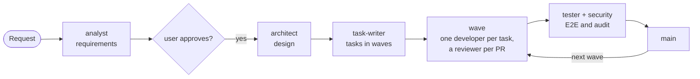

# pocket-it

An agent system for [Claude Code](https://claude.com/claude-code). It takes a feature from the request to `main` through seven agents, each with one job: **analyst**, **architect**, **task-writer**, **developer**, **reviewer**, **security**, **tester**. The main session only launches them, carries their questions to the user, merges and reports.

Hooks stop an agent before it does harm. Scripts enforce the gates: pre-merge checks, security sign-off, end-to-end tests. A rule is written only when no script can enforce it.

## How it works



Each wave is a group of independent tasks that run in parallel, each developer in its own git worktree. A wave reaches `main` only with green end-to-end tests and the security sign-off.

## Why this way

- **One job per agent.** Every agent file is 20–45 lines. An agent that knows less about the rest of the flow makes fewer assumptions about it.
- **Proof in the PR.** Every acceptance criterion has a command; the developer pastes the runs in the PR, the reviewer reads them, `pre-merge.sh` reruns the fast checks before the merge.
- **Gates are scripts, not sentences.** Pushes to `main`, force pushes, edits outside a worktree, costly commands and writes to the global memory are blocked by hooks, each with its own test cases.
- **Isolation by default.** Each agent works in its own git worktree, and its Bash runs inside the Claude Code sandbox: project only, GitHub and npm only, no `.env`.
- **Errors are sorted.** Damage ends in a removed instruction, a new hook or, last, a rule. Friction gets one line.

## Install

```bash
git clone https://github.com/FCabiddu/pocket-it.git ~/Desktop/agents
ln -s ~/Desktop/agents ~/.claude/agents     # Claude Code loads */.claude/agents/*.md from here
ln -sf ~/Desktop/agents/flow/CLAUDE.md ~/.claude/CLAUDE.md   # global rules
~/Desktop/agents/link-skills.sh             # rebuilds ~/.claude/skills
```

Then wire the hooks in `~/.claude/settings.json` (table in [`flow/README.md`](flow/README.md#hook-wiring)) and run `flow/bin/project-ready.sh` once in each project. Requirements: macOS or Linux, bash, python3, git, `gh` logged in.

## Read more

| Where | What |
|---|---|
| [`flow/FLOW.md`](flow/FLOW.md) | The flow in three diagrams: the big picture, a wave, E2E and errors |
| [`flow/README.md`](flow/README.md) | Who does what, the scripts, the project templates, the hooks, how to run their tests |
| [`flow/CLAUDE.md`](flow/CLAUDE.md) | The global rules every session follows |
| `mvp-builder/` | A separate agent that builds static sites, with its `design-compass.md` |
