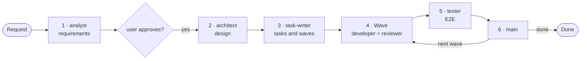
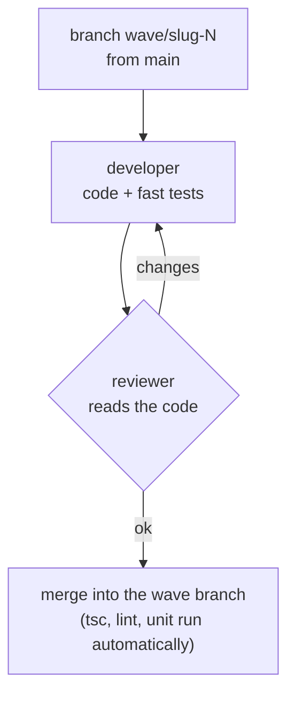
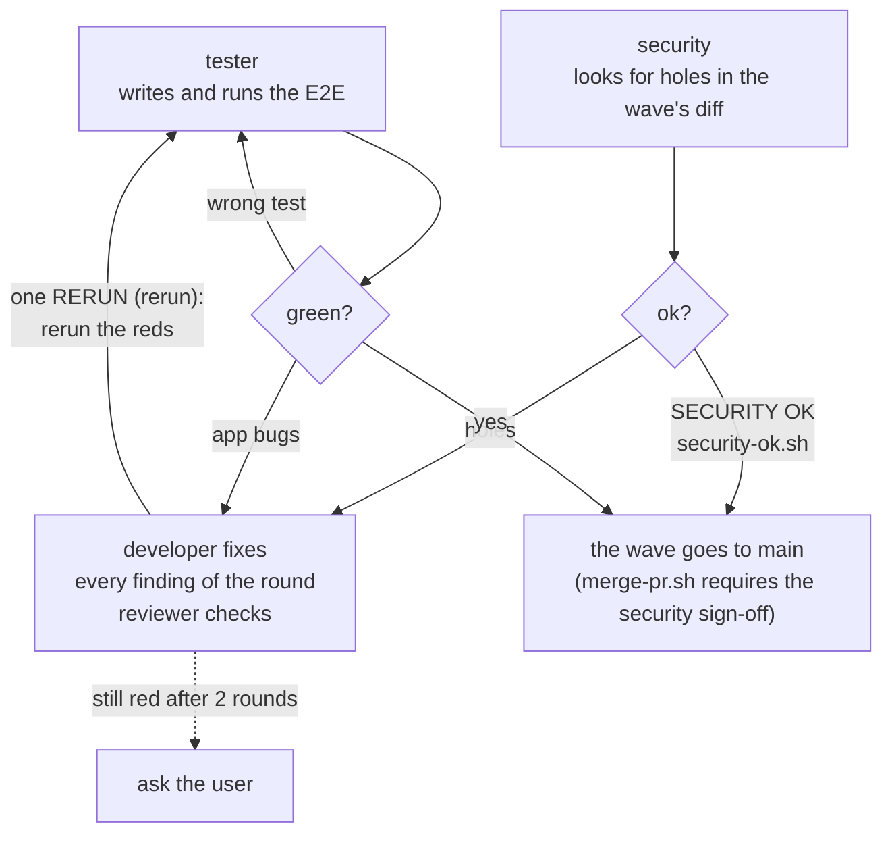

# The lite flow

The flow described by `CLAUDE.md` (rules v7), the agents in `.claude/agents/`, the scripts in `bin/` and the hooks in `hooks/`. It is updated whenever one of them changes. What every agent, script and hook does is in the [README](../README.md#lite).

## 1 · The big picture

Once, at the start of a project, `project-ready.sh` checks that the project has the scripts the flow uses (`templates/README.md`); whatever is missing, the architect creates from the templates. A feature goes through these steps; small work (a bug, a change) is done by the main session alone, on a branch, with a PR and a merge.

## 2 · A wave

The tasks of a wave run in parallel, each with its own developer.

## 3 · E2E and errors

At the end of a wave, before `main`, tester and security work in parallel; their findings are fixed together. If the project's directives defer the E2E (for example to the release), the tester writes them without running them and the wave goes to `main` with its approved PR. If a choice is needed that the design did not make, the architect decides (and the user, if there is something to decide).

## End of a wave

With the wave on `main`: `errors.sh` and the agents' reports; every friction is one line in `docs/recap/friction.md` (the third time it is damage), every damage a recap discussed with the user; then `clean-wave.sh` removes the wave's tasks from `main`, and the next wave starts.
