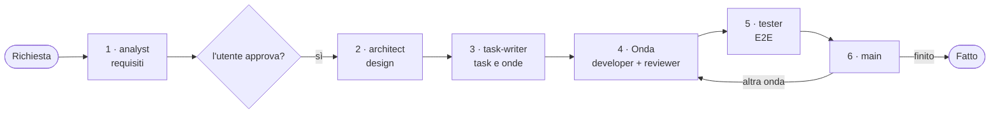
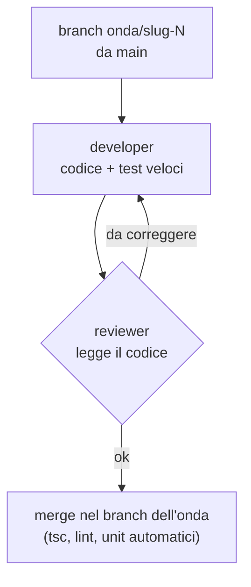
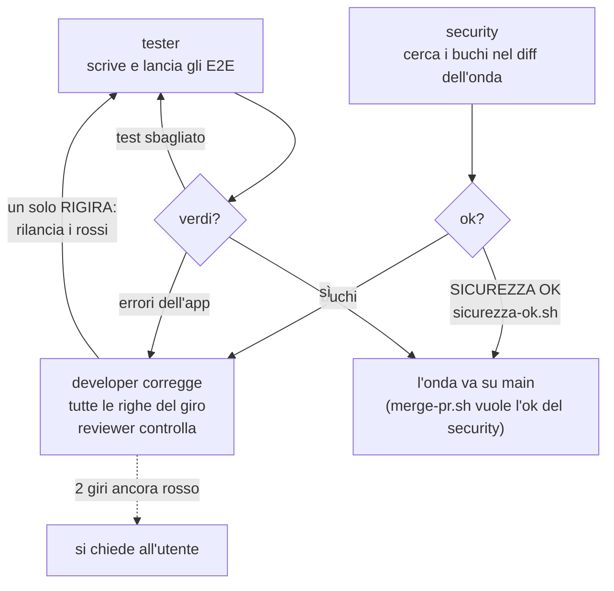

# Flusso del sistema lite

Il flusso descritto da `CLAUDE.md` (regole v7), dagli agenti in `.claude/agents/`, dagli script in `bin/` e dagli hook in `hooks/`. Va aggiornato quando cambia uno di questi. Cosa fa ogni agente, script e hook è nel [README](../README.md#lite).

## 1 · Il quadro

All'inizio di un progetto, una volta, `progetto-pronto.sh` controlla che il progetto abbia gli script che il flusso usa (`templates/README.md`); se manca qualcosa, l'architect lo crea dai modelli. Una feature passa da questi passi; il lavoro piccolo (bug, modifica) lo fa la sessione principale da sola, su un branch, con PR e merge.

## 2 · Un'onda

I task di un'onda girano in parallelo, ognuno con il suo developer.

## 3 · Gli E2E e gli errori

A fine onda, prima di main, tester e security lavorano in parallelo; le loro righe si correggono insieme. Se le direttive del progetto rimandano gli E2E (per esempio al rilascio), il tester li scrive senza lanciarli e l'onda va su main con la sua PR approvata. Se serve una scelta che il design non ha fatto, decide l'architect (e l'utente se c'è da decidere).

## Fine onda

Con l'onda su main: `errori.sh` e i report degli agenti; ogni attrito è una riga in `docs/recap/attriti.md` (alla terza volta è un danno), ogni danno un recap discusso con l'utente; poi `pulisci-onda.sh` toglie da main i task dell'onda, e parte l'onda dopo.
